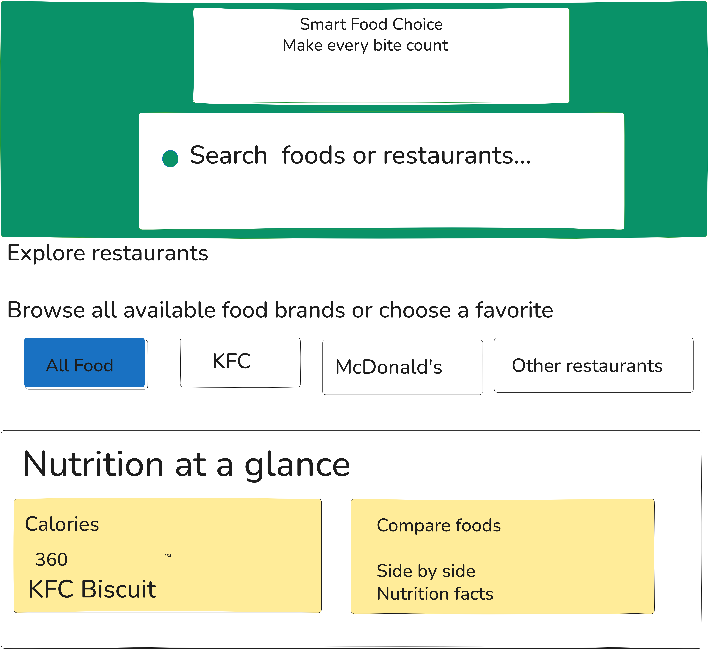

# Smart Food Choice

## The Problem:

Families, students and busy workers often choose fast food without knowing how much calories, protein, fat, carbohydrates, or sodium their meals contain. They need a simple way to check and compare nutritional information before ordering.

## The Plan:

### Data:
Dataset: `Fast Food Nutrition`

|ID | Name | Type | Vendor | Calories | Fat (g)| Protein (g) | Carb (g) | Chol (mg) | Sat Fat (g) | Sodium (mg) | Serving Wt (g) | 200 Cal Wt (g) | 
|---|---|---|---|---:|---:|---:|---:|---:|---:|---:|---:|---:|
| 1 | Kfc Biscuit | Biscuit | KFC | 358.0 | 17.05 | 7.5 | 43.55 | 1.0 | 11.916 | 1070.0 | 49.0 | 55.866 |
| 2 | McDonalds Bacon Egg & Cheese Biscuit | Biscuit | McDonalds | 304.0 | 18.77 | 13.45 | 22.26 | 167.0 | 8.262 | 863.0 | 142.0 | 65.789 |
| 3 | McDonalds Sausage Biscuit | Biscuit | McDonalds | 376.0 | 25.4 | 9.62 | 27.2 | 29.0 | 10.659 | 875.0 | 117.0 | 53.191 |

### Sections
- A visitor sees a place to search for food and choose a restaurant.
- A visitor sees nutrition information and can compare food items.

### User action
- A visitor types a food name or restaurant, and the page displays matching food items.
- A visitor selects two foods, and the page compares their nutritional information.

## Team
Accountability partner:@helloimshanae

## The Plan:

## Links

- Live : https://smartfoodchoice.netlify.app/
- Repo : https://github.com/edwardcoded77/fast-food-nutrition-2026
